# Architecture

The layers and the reasons behind them are in [decisions.md](decisions.md), decision 1.

```mermaid
flowchart TB
    subgraph controllers["controllers/"]
        CLI["CliController<br/>parse args, wire dependencies<br/>report and backtest commands<br/>--sector --ev --ownership --margin --region<br/>--min-strategics --csv --out<br/>--record --replay --recordings"]
    end

    subgraph services["services/"]
        Report["AcquirerReportService<br/>orchestrates the workflow"]
        Profile["TargetProfileService<br/>check CLI inputs, resolve margin floor"]
        Scoring["CandidateScoringService<br/>select and rank 10, --min-strategics"]
        Evidence["EvidenceBuilderService<br/>precedents, comps, peer baselines,<br/>conviction, data risks"]
        OnePager["AcquirerOnePagerService<br/>build prompt, call LLM in parallel,<br/>retry once on validation failure"]
        Validator["OutputValidatorService<br/>schema, cited IDs, number grounding,<br/>risk count, banned phrases, section length"]
        Similarity["SectorSimilarityService<br/>sector closeness from sponsor overlap"]
        ModelI["AcquirerRankingModel<br/>(interface)"]
        Weighted["SimilarityWeightedCount"]
        Baseline["DealCountBaseline"]
        Backtest["BacktestService<br/>time-split hit@10 and MRR<br/>refits each model before every held-out deal"]
    end

    subgraph repositories["repositories/"]
        RepoI["TransactionRepository<br/>(interface)"]
        Csv["CsvTransactionRepository<br/>load, clean, apply data rules"]
    end

    subgraph clients["clients/"]
        LlmI["LlmClient<br/>(interface)"]
        Anthropic["AnthropicClient"]
        Recording["RecordingClient<br/>wraps AnthropicClient, saves responses"]
        Recorded["RecordedClient"]
    end

    Prompts["prompts/<br/>system.md, lens_sponsor.md,<br/>lens_strategic.md, acquirer.md"]

    subgraph views["views/"]
        Md["MarkdownView<br/>summary.md, one file per acquirer"]
        Json["JsonView<br/>one_pagers.json"]
        RunLog["RunLogView<br/>run_log.json"]
    end

    Models["models/<br/>Transaction, TargetProfile, RankingScore,<br/>EvidencePack, ValuationComps, RiskFlag,<br/>ConvictionLevel, AcquirerOnePager<br/>(shared by all layers)"]

    CSVFile[("ma_transactions_500.csv")]
    API(["Anthropic API"])
    Cache[("recorded responses")]

    CLI --> Report
    CLI --> Md
    CLI --> Json
    CLI --> RunLog
    Report --> RepoI
    Report --> Profile
    Report --> Scoring
    Report --> Evidence
    Report --> OnePager
    OnePager --> Validator
    OnePager --> LlmI
    OnePager --> Prompts
    CLI --> Backtest
    Backtest --> RepoI
    Backtest --> ModelI
    Scoring --> ModelI
    Weighted --> Similarity
    Evidence --> Similarity
    Weighted -. implements .-> ModelI
    Baseline -. implements .-> ModelI
    Csv -. implements .-> RepoI
    Anthropic -. implements .-> LlmI
    Recorded -. implements .-> LlmI
    Recording -. implements .-> LlmI
    Recording --> Anthropic
    Recording --> Cache
    Csv --> CSVFile
    Anthropic --> API
    Recorded --> Cache
```

Solid arrows are calls or dependencies. Dotted arrows connect a concrete class to the interface it implements. The controller is the only place that names `CsvTransactionRepository`, `AnthropicClient`, `RecordingClient`, `RecordedClient`, `SimilarityWeightedCount`, or `DealCountBaseline`.
